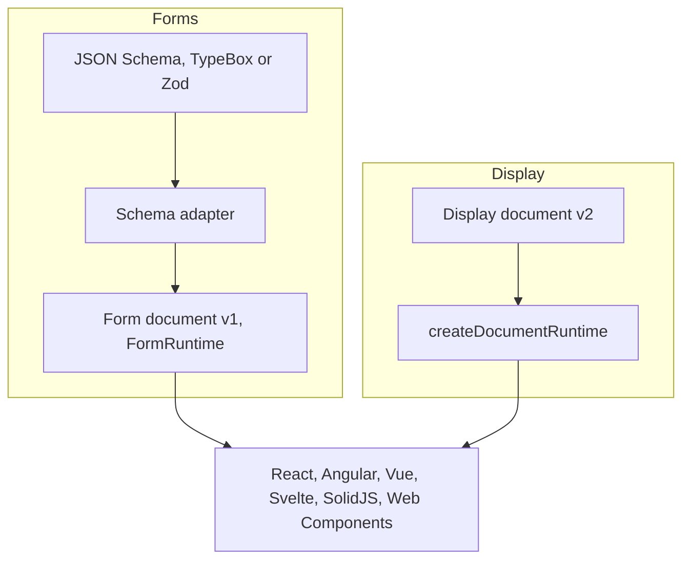

<p align="center">
  
</p>

<h1 align="center">Texaryn</h1>

<p align="center">
  <strong>Framework-neutral runtime for schema-driven interfaces.</strong>
</p>

<p align="center">
  Compile data semantics into a UI IR, run it through a headless runtime, and render it through React, Angular, Vue, Svelte, SolidJS, or another framework binding.
</p>

<p align="center">
  Supports JSON Schema Draft 4, Draft 7, 2019-09 and 2020-12, with automatic dialect detection.
  See <a href="https://texaryn.github.io/texaryn/guides/json-schema-support/">JSON Schema support</a> for form generation capabilities and validation limits.
</p>

<p align="center">
  <a href="https://github.com/texaryn/texaryn/actions/workflows/ci-release.yml">
    
  </a>
  <a href="https://codecov.io/gh/texaryn/texaryn">
    
  </a>
  <a href="./LICENSE">
    
  </a>
</p>

<p align="center">
  <a href="https://texaryn.github.io/texaryn/">Documentation</a> •
  <a href="https://texaryn.github.io/texaryn/playground/">Playground</a> •
  <a href="https://texaryn.github.io/texaryn/start/getting-started/">Getting Started</a> •
  <a href="https://texaryn.github.io/texaryn/api/">API Reference</a> •
  <a href="./ROADMAP.md">Roadmap</a>
</p>

---

## Why Texaryn?

Most schema-driven form libraries tie three things together: how the schema is read, where form state lives, and which framework renders it. Changing one means changing all three.

Texaryn keeps them apart:

- **Schema semantics stay in the adapter.** The JSON Schema adapter, which also takes TypeBox output, and the Zod adapter resolve conditionals, composition and references in one place. They re-project as the data changes, and no renderer reimplements them.
- **State lives in a headless runtime.** Values, validation, touched and dirty state, submission and array identity sit in `@texaryn/core`, which imports no framework, no DOM and no AI SDK.
- **Renderers only render.** Each framework binding draws a typed UI document. The same form runs unchanged in React, Angular, Vue, Svelte, SolidJS or plain custom elements.
- **The UI is data.** Documents are serializable, so a server, a visual builder or a model can produce one without generating or evaluating code.

## Quick start

```bash
pnpm add @texaryn/core @texaryn/schema-json @texaryn/react react react-dom
```

In a Vite React TypeScript app, replace `src/main.tsx` with the code below and run `pnpm dev`. The template's `index.html` already has the `root` element.

```tsx
import { createRoot } from 'react-dom/client'
import { createJsonSchemaAdapter } from '@texaryn/schema-json'
import {
  ErrorSummary,
  FormProvider,
  FormRoot,
  createDefaultRegistry,
  useForm,
} from '@texaryn/react'

const adapter = await createJsonSchemaAdapter({
  $schema: 'https://json-schema.org/draft/2020-12/schema',
  type: 'object',
  title: 'Profile',
  required: ['name'],
  properties: {
    name: { type: 'string', title: 'Name', minLength: 2 },
    age: { type: 'integer', title: 'Age', minimum: 18 },
    newsletter: { type: 'boolean', title: 'Subscribe to newsletter' },
  },
})
const registry = createDefaultRegistry()

function App() {
  const form = useForm(adapter, {
    initialData: { name: '', newsletter: false },
    onSubmit: async (data) => console.log('Submitted', data),
  })

  return (
    <FormProvider value={form.runtime}>
      <ErrorSummary />
      <FormRoot registry={registry} />
      <button type="button" onClick={() => form.dispatch({ type: 'Submit' })}>
        Submit
      </button>
    </FormProvider>
  )
}

createRoot(document.getElementById('root')!).render(<App />)
```

The adapter reads the schema, `useForm` creates the runtime, and `FormRoot` renders one field per property with the default widgets. Submitting validates first, so an empty name shows an error instead of reaching `onSubmit`.

[Getting started](https://texaryn.github.io/texaryn/start/getting-started/) adds validation triggers, UI hints and the full submission lifecycle. The [playground](https://texaryn.github.io/texaryn/playground/) runs the example catalog in React, Vue, Svelte, SolidJS and Web Components.

## Architecture

Texaryn has two kinds of document. Forms start from a schema. Display documents are written directly and have no editable fields. Both reach the same framework bindings.



The [architecture page](https://texaryn.github.io/texaryn/concepts/architecture/) covers the package boundaries, and [What is Texaryn?](https://texaryn.github.io/texaryn/start/what-is-texaryn/) walks through each stage.

## Capabilities

| Area | Support |
| --- | --- |
| Schema sources | JSON Schema Draft 4, Draft 7, 2019-09 and 2020-12 with dialect detection. TypeBox through its JSON Schema output. Zod 4 through `@texaryn/schema-zod`. |
| JSON Schema features | Conditionals, `oneOf` and `anyOf`, dependencies, local, static external and recursive `$ref`, with errors mapped to JSON Pointers. [Support and limits](https://texaryn.github.io/texaryn/guides/json-schema-support/). |
| Framework bindings | React, Angular, Vue, Svelte, SolidJS and Web Components, each with default widgets for forms and display documents. |
| Widget integrations | Bootstrap 5 and Material UI v9, both for React. Any binding accepts custom widgets through its registry. |
| Display documents | Lists, tables, layouts, text and host actions, with no schema. [Guide](https://texaryn.github.io/texaryn/guides/display-documents/). |
| Collaboration | Optional Yjs binding for shared scalar field edits. |
| AI generation | A versioned output contract for model-generated forms and display documents, checked by the same validators. [Guide](https://texaryn.github.io/texaryn/guides/ai-generation/). |
| Migration | A [guide from react-jsonschema-form](https://texaryn.github.io/texaryn/guides/migrating-from-rjsf/). |

## Packages

Each package is versioned independently. Its badge shows the latest npm version and links to that package's npm page.

| Package | Version | Purpose |
| --- | --- | --- |
| [`@texaryn/core`](https://www.npmjs.com/package/@texaryn/core) | [](https://www.npmjs.com/package/@texaryn/core) | UI documents, compiler, form and document runtimes, renderer registry |
| [`@texaryn/schema-json`](https://www.npmjs.com/package/@texaryn/schema-json) | [](https://www.npmjs.com/package/@texaryn/schema-json) | JSON Schema evaluation and validation adapter |
| [`@texaryn/schema-zod`](https://www.npmjs.com/package/@texaryn/schema-zod) | [](https://www.npmjs.com/package/@texaryn/schema-zod) | Zod 4 validation adapter with JSON Schema projection |
| [`@texaryn/react`](https://www.npmjs.com/package/@texaryn/react) | [](https://www.npmjs.com/package/@texaryn/react) | React hooks, renderer and default widgets |
| [`@texaryn/react-bootstrap`](https://www.npmjs.com/package/@texaryn/react-bootstrap) | [](https://www.npmjs.com/package/@texaryn/react-bootstrap) | Bootstrap 5 widgets for `@texaryn/react` |
| [`@texaryn/react-mui`](https://www.npmjs.com/package/@texaryn/react-mui) | [](https://www.npmjs.com/package/@texaryn/react-mui) | Material UI v9 widgets for `@texaryn/react` |
| [`@texaryn/angular`](https://www.npmjs.com/package/@texaryn/angular) | [](https://www.npmjs.com/package/@texaryn/angular) | Angular signals, standalone components and default widgets |
| [`@texaryn/vue`](https://www.npmjs.com/package/@texaryn/vue) | [](https://www.npmjs.com/package/@texaryn/vue) | Vue 3 composables, renderer and default widgets |
| [`@texaryn/svelte`](https://www.npmjs.com/package/@texaryn/svelte) | [](https://www.npmjs.com/package/@texaryn/svelte) | Svelte 5 store bridge, components and default widgets |
| [`@texaryn/solid`](https://www.npmjs.com/package/@texaryn/solid) | [](https://www.npmjs.com/package/@texaryn/solid) | SolidJS components and default widgets |
| [`@texaryn/web-components`](https://www.npmjs.com/package/@texaryn/web-components) | [](https://www.npmjs.com/package/@texaryn/web-components) | `<texaryn-form>` custom element with native widgets, for any framework or none |
| [`@texaryn/collaboration-yjs`](https://www.npmjs.com/package/@texaryn/collaboration-yjs) | [](https://www.npmjs.com/package/@texaryn/collaboration-yjs) | Optional Yjs adapter for shared scalar field edits |

## Documentation

The documentation lives at [texaryn.github.io/texaryn](https://texaryn.github.io/texaryn/), with a generated [API reference](https://texaryn.github.io/texaryn/api/). Coding agents can read [llms.txt](https://texaryn.github.io/texaryn/llms.txt), or the whole site as Markdown in [llms-full.txt](https://texaryn.github.io/texaryn/llms-full.txt).

Each package README is a quick reference for that package. The site's sources are in [`apps/docs`](apps/docs), and maintainer material such as the [release runbook](docs/releasing.md) and design records is in [`docs/`](docs/README.md).

## Development

Texaryn is a pnpm monorepo. Workspace packages resolve through their compiled output, so build before running anything else.

```bash
pnpm install
pnpm build
pnpm typecheck
pnpm test
pnpm --filter @texaryn/playground dev
```

## Status

The first stable compatibility contract covers `@texaryn/core`, `@texaryn/schema-json`, and `@texaryn/react`. Each package versions independently. Packages below 1.0.0 remain pre-stable and may change between minor releases. The [roadmap](ROADMAP.md) records the release gate and follow-up triggers.

Issues and focused pull requests are welcome. For a change to a package boundary, open an issue first.

---

<p align="center">
  <strong>Schema semantics in. Deterministic UI out.</strong>
</p>
