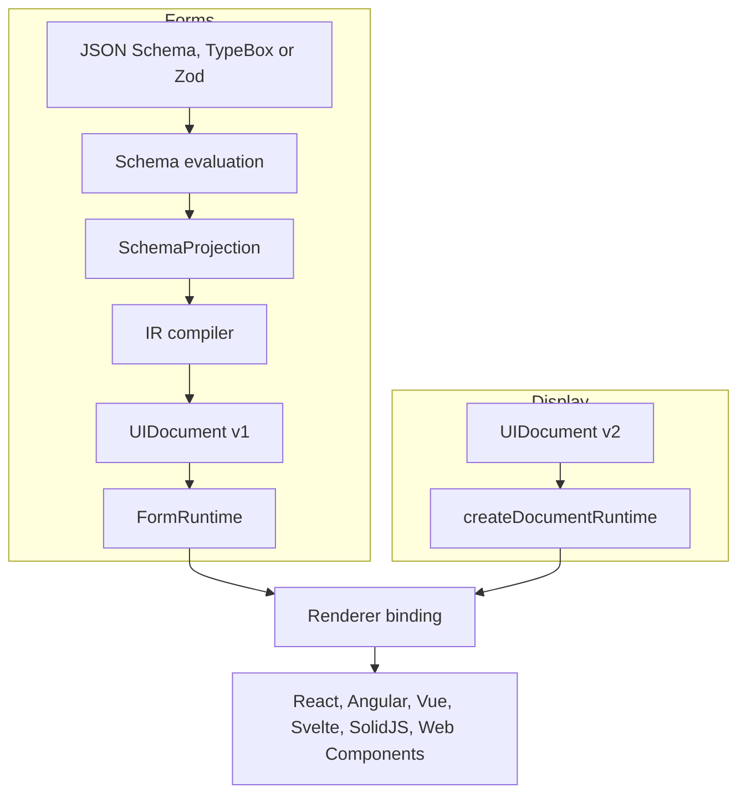

Texaryn is a TypeScript runtime for schema-driven forms and standalone display
documents. It manages behavior independently of the framework that draws the
interface.

Use it when a form follows a schema, when the fields change with the answers,
or when the same data contract needs different framework or design system
integrations. You keep control of the components and application logic.

## Forms or display documents?

- **Forms edit data.** Start from JSON Schema, TypeBox or Zod. Texaryn projects
  fields from the schema and current values, manages validation and submission,
  and renders controls through a framework binding.
- **Display documents present data.** Describe lists, tables, layouts, text and
  actions directly, without a schema adapter or editable fields. The host
  application supplies action handlers.

A display document is not a newer replacement for a form document. They have
different contracts and use different runtimes.

## Two paths, one set of bindings

Every stage is a value you can inspect, and nothing above the renderer binding
knows which framework will draw the result.

On the form path, a schema adapter owns evaluation and projection, so
conditionals, composition and references are resolved before anything is
compiled. `FormRuntime` asks the adapter for a new projection whenever the
data changes, which is how a conditional field appears or disappears.

On the display path there is no adapter. `createDocumentRuntime` validates the
version 2 document and its data, and list and table nodes read rows through
JSON Pointers. The [display documents guide](/texaryn/guides/display-documents/)
covers the node types.

## Widgets

Every binding ships default widgets for both kinds of document, and every
binding accepts custom widgets through its registry. React also has two
widget packages, `@texaryn/react-bootstrap` for Bootstrap 5 and
`@texaryn/react-mui` for Material UI. Neither works with the other bindings.
The default React widgets can also be styled with Emotion or Tailwind, as the
[custom styling guide](/texaryn/guides/custom-styling/) shows.

## Why the separation matters

A renderer receives a typed document rather than a schema, so a design system
integration never reimplements schema semantics. Conditionals, composition and
dependencies are resolved in one place, and every renderer inherits the
result.

That is also what makes the claim testable. CI runs the shared example
catalog through the React, Vue, Svelte and Web Components renderers, and the
Angular and SolidJS bindings have renderer suites of their own.

## Start building

Follow [Getting started](/texaryn/start/getting-started/) for a complete React
form, or [choose your packages](/texaryn/start/choose-packages/) for another
framework. For an interface without editable fields, start with
[Display documents](/texaryn/guides/display-documents/).

The [roadmap](/texaryn/roadmap/) records package stability. The core, JSON
Schema adapter and React binding are at 1.0; other packages remain below 1.0.
