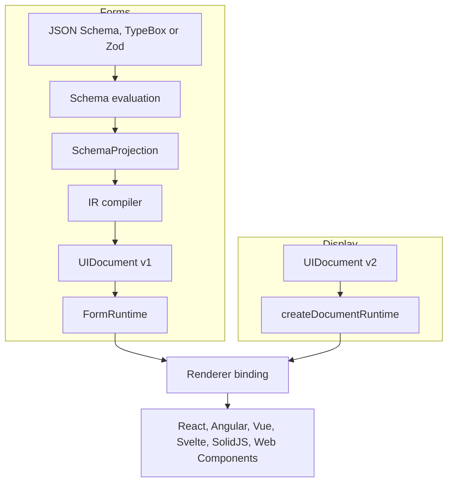

Texaryn sits between a declarative description of a domain and the interface a
particular framework renders for it. You describe what the data is; Texaryn
decides what the interface has to express; a renderer decides how it looks.

Texaryn handles two kinds of document. A form starts from a schema and edits
data. A display document is written directly and presents data as lists,
tables, layouts, text and actions, with no schema and no editable fields.

## Two paths, one set of bindings

Every stage is a value you can inspect, and nothing above the renderer binding
knows which framework will draw the result.

On the form path, a schema adapter owns evaluation and projection, so
conditionals, composition and references are resolved before anything is
compiled. `FormRuntime` asks the adapter for a new projection whenever the
data changes, which is how a conditional field appears or disappears.

On the display path there is no adapter. `createDocumentRuntime` validates the
version 2 document and its data, and list and table nodes read rows through
JSON Pointers. The [display documents guide](/texaryn/guides/display-documents/)
covers the node types.

## Widgets

Every binding ships default widgets for both kinds of document, and every
binding accepts custom widgets through its registry. React also has two
widget packages, `@texaryn/react-bootstrap` for Bootstrap 5 and
`@texaryn/react-mui` for Material UI. Neither works with the other bindings.
The default React widgets can also be styled with Emotion or Tailwind, as the
[custom styling guide](/texaryn/guides/custom-styling/) shows.

## Why the separation matters

A renderer receives a typed document rather than a schema, so a design system
integration never reimplements schema semantics. Conditionals, composition and
dependencies are resolved once, in one place, and every renderer inherits the
result.

That is also what makes the claim testable. The same example runs through
every supported renderer, so "framework neutral" is something the build
checks rather than something the README says.

## Status

The guides, concept pages and a generated API reference all live on this
site. Each package README in the repository stays a quick reference for
that package.
