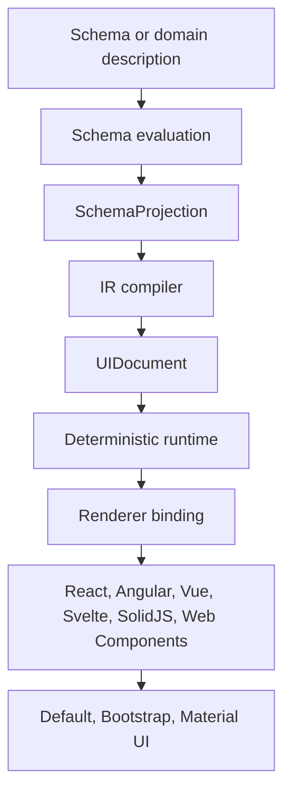

Texaryn sits between a declarative description of a domain and the interface a
particular framework renders for it. You describe what the data is; Texaryn
decides what the interface has to express; a renderer decides how it looks.

Forms are the first domain, and the intent is that they become excellent
before anything else is attempted.

## The pipeline

Every stage is a value you can inspect, and no stage below the binding knows
which framework will render it.

## Why the separation matters

A renderer receives a typed document rather than a schema, so a design system
integration never reimplements schema semantics. Conditionals, composition and
dependencies are resolved once, in one place, and every renderer inherits the
result.

That is also what makes the claim testable. The same example runs through
every supported renderer, so "framework neutral" is something the build
checks rather than something the README says.

## Status

The guides, concept pages and a generated API reference all live on this
site. Each package README in the repository stays a quick reference for
that package.
